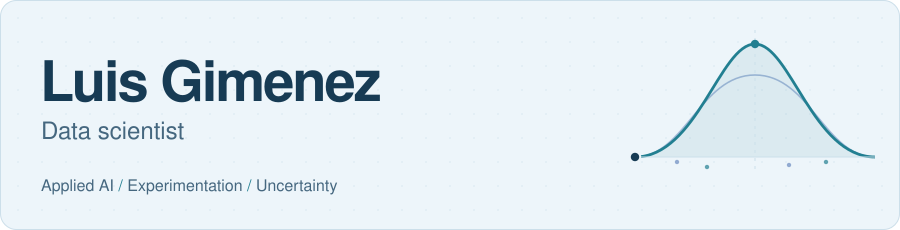

<picture>
  <source media="(prefers-color-scheme: dark) and (max-width: 600px)" srcset="assets/header-dark-mobile.svg">
  <source media="(max-width: 600px)" srcset="assets/header-light-mobile.svg">
  <source media="(prefers-color-scheme: dark)" srcset="assets/header-dark.svg">
  
</picture>

I build Python tools and explore how data can support better decisions.

### Selected work

<table>
<tr>
<td width="72" align="center"></td>
<td>
<h3><a href="https://github.com/luisgius/AI-Book-recommender/tree/15-12-llm">Book recommender</a></h3>

Find books through hybrid search and LLM-generated explanations.

BM25, embeddings and retrieval evaluation. <a href="https://github.com/luisgius/AI-Book-recommender/blob/15-12-llm/docs/PORTFOLIO_GUIDE.md">Architecture and evaluation</a>.

</td>
</tr>
</table>

<table>
<tr>
<td width="72" align="center"></td>
<td>
<h3><a href="https://github.com/luisgius/job_search">Job Hunter</a></h3>

Collect job postings, filter requirements and generate a digest for review.

Python pipelines and LLM-assisted scoring. <a href="https://github.com/luisgius/job_search/blob/claude/job-hunter-daily-pipeline-hbl7li/docs/PORTFOLIO_GUIDE.md">How it works</a>.

</td>
</tr>
</table>

<table>
<tr>
<td width="72" align="center"></td>
<td>
<h3><a href="https://github.com/luisgius/stock-market-rl-lab">Stock-market RL lab</a></h3>

Can reinforcement learning beat simple allocation strategies after trading costs?

Experiments, an adverse result and its limitations. <a href="https://github.com/luisgius/stock-market-rl-lab/blob/main/docs/results.md">Results</a>.

</td>
</tr>
</table>

### Currently exploring

[Bayesian and frequentist inference](https://github.com/luisgius/bayes-frequentist) for weak signals near a physical boundary. **Work in progress.**

[LinkedIn](https://www.linkedin.com/in/luis-gimenez-uso/)
